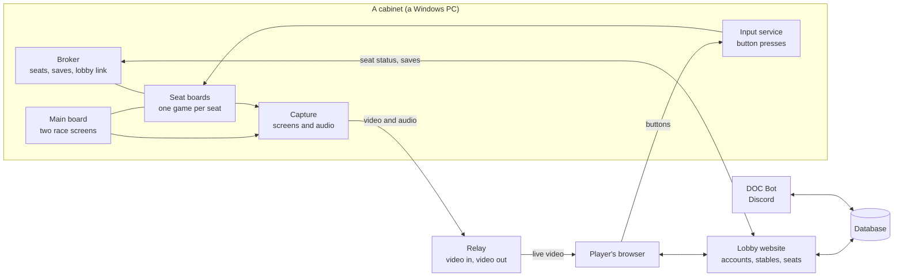

# How DOC Online is built

Derby Owners Club was an arcade cabinet: two big race screens driven by a main board, and a ring of
player seats, each its own game board, linked together. DOC Online keeps that shape. A cabinet is a
Windows PC running one emulated board per screen and per seat. Players sit down from a web browser
anywhere, watch their seat and the race as live video, and press buttons that travel back to their seat.

## The cabinet

**The boards.** Each board is a copy of the Flycast emulator running the game. The main board drives
both race screens; each seat runs its own board. The boards link to each other on the PC itself, the
way the original cabinet's boards were wired together. A full eight-seat cabinet is ten game windows:
the main board, its second screen, and eight seats. The race needs at least four seats to fill the
field properly.

**The broker** is the cabinet's manager. It knows which seats are free or taken, tells the lobby, puts a
player's horse into their seat when they sit down, and sends the horse back to the website when they
save. Small watchdog scripts alongside it restart anything that falls over.

**The input service** receives each remote player's button presses and delivers them only to the seat
that player holds.

**Seat stations** (`toolkit/host-pack/slot_station.py`) are small local services, one per seat, that
the broker uses to put a horse card in or take it out. They only listen on the PC itself.

**Setup and launch** (`toolkit/host-pack/setup/`, `_launch.ps1`) find the installed boards, write each
board's window position and link settings, register the scheduled tasks that keep hosting running,
and start everything in the right order. Setup ends by checking that the lobby can actually see this
cabinet's seats and video, because a cabinet can look healthy locally while the lobby shows a black
board.

**Pairing.** The first time you run Setup it pairs the PC to your account with a one-time code. The
result is a private `cabinet.json` holding this cabinet's id and its own key. Nothing in the toolkit
contains a key: every script reads it from that file, and the relay only accepts a cabinet's key for
that cabinet's own streams.

## Video and sound

Each screen is captured straight from its game window (`toolkit/streaming/wgc_relay_push.py`), encoded
to H.264 on the graphics card when one is available (Cabinet Doctor tests which encoders work), and pushed
to the relay. The two race screens are joined side by side into one stream (`mains_combine.py`) so the
halves can never drift apart. Race audio and each seat's own sound are captured separately
(`audio_relay_push.py`) and never mixed into the video, which kept everything in sync.

The relay is a media server on an always-on server. Cabinets push to it; players' browsers pull from it
over WebRTC, which keeps the delay low enough to play by. Every remote player is watching video sent
from the host's PC, so the host's **upload** speed is everyone's picture.

## The lobby and saves

The lobby website is where players sign in, see which cabinets have open seats, pick a seat and race.
Behind it is a database holding accounts, stables and every horse. When a player saves at a cabinet,
the broker hands the horse to the website, which checks it and stores it in that player's stable.
Horses live in the stable, never on the host's PC, so a player's horse is the same at every cabinet.

## DOC Bot

DOC Bot lives in the community Discord. It answers game questions from the arcade's own data, looks up
stables and horses, and reads Cabinet Doctor reports to help hosts fix problems.

## What is not described here

How the arcade checks horses, keeps races fair and handles abuse is deliberately left out. Those
systems work partly because the details aren't public.
